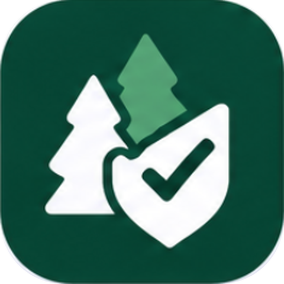

<p align="center">
  
</p>

<h1 align="center">DartAsk</h1>

<p align="center">
  A mobile web app that helps Dartmouth students, starting with international students, ask for help.<br />
  <em>AI can make asking easier. Only people can help.</em>
</p>

---

## Why

Most students would happily help a classmate. Asking is the hard part, especially when you are new, far from home and have no car, no family nearby and no idea who to ask. Today's workaround is the group chat, and it makes asking harder: you post to hundreds of people at once, each community has its own chat, an unanswered message is buried in twenty minutes, and the same questions come back every term.

DartAsk was built for the hackathon theme "AI at 70: What must remain human?". Our answer: AI lowers the barrier to asking, and the helping stays human. The AI turns a vague, awkward need into a clear, small ask with a fair price. It never does the helping, and it never sends anything without a tap.

## How an ask works

1. **Board.** `/` is the needs board: open asks from other students, filterable by category. Anyone can browse it.
2. **Ask.** "Ask for help" opens a short form at `/ask` (what, when, where, how long, price; $0 makes it a favor). AI suggestions appear only when you tap for them. Or tap "Let AI help", type the messy version, answer at most two quick questions, and AI breaks it into small, editable asks (`/describe` -> `/clarify` -> `/draft`).
3. **Quick check.** `/check` runs the safety check on the final wording, and shows "You're not the only one" with a tip from a past helper when the ask is a common one.
4. **Where.** `/where` picks the route: the public board, a partner group chat, or privately to a few matched helpers who are free at that time.
5. **Share.** `/share` previews exactly what will be posted. Every ask is anonymous; the privacy check shows what it removed, with Undo. One tap posts it to the board, and, if a group is picked, the DartAsk bot posts the same card to GroupMe.
6. **Claim.** A helper opens the card (`/h/<token>`) from the board or the GroupMe link, signs in and taps "I can help". Everyone else now sees "Already taken", on the board and from the group link alike.
7. **Confirm and pay to hold.** The asker confirms the helper, and the bot posts "Covered" to the group without naming anyone. The asker pays to hold the money (mocked; a $15 ask is $17.28 with the 10% platform fee and card processing, see `src/lib/ask/fees.ts`). The two talk in an in-app thread and meet somewhere public.
8. **Done and thanks.** The helper taps Done, the asker confirms, the payment is released, and the asker writes a thank-you in their own words. If the asker never responds, payment auto-releases 48 hours after Done unless they report a problem; cancelling before Done refunds.

Private asks land in matched helpers' inboxes, where they can say "I can help" or "Not this time" (no reason asked).

## Guardrails

These are product rules, enforced on the server, not just in the UI.

- **Safety first.** Every ask is checked before anything else. Crisis-type messages get professional resources only (988 and campus counseling) and are never matched or posted. "Write my essay" goes to tutoring and the writing center, never to a paid or public ask. Visa, money and health asks can't go to the board or a group. The model can only make a safety result stricter than the keyword check, never looser.
- **Nothing happens without a tap.** Nothing is sent, posted, paid or added to a calendar on its own.
- **Fully anonymous.** Students only ever see each other's alias (for example "Steady Loon 42"), never a name, email or phone, even after a match. Askers show as "A classmate" on cards.
- **Post-only bot.** The GroupMe bot has no callback URL, so it never receives or reads group messages. It introduces itself once when added to a group and posts at most 3 asks per group per day.
- **Scam guard.** Messages that suggest paying outside DartAsk or ask for an ID number get a warning for the sender and a note for the receiver.
- **Visa-aware payments.** Helpers say whether they can accept payment; paid asks never reach those who can't (many F-1 students). Favors go to everyone.
- **No overload.** Helpers set a weekly limit and matching spreads the load.
- **No scores.** No ratings, streaks or leaderboards. The thank-you note is the only feedback.

## What's real and what's mocked

| Part      | Tonight                                                                                                                                                  |
| --------- | -------------------------------------------------------------------------------------------------------------------------------------------------------- |
| AI steps  | Real with `ANTHROPIC_API_KEY`; each step has a canned fallback (`src/lib/ai/ask/fallback.ts`) when there is no key or the call fails                     |
| Group bot | Posts to the real GroupMe with `GROUPME_BOT_ID` (Slack with `SLACK_WEBHOOK_URL`); otherwise logged as `[mock:<platform>]`                                |
| Database  | Postgres. Locally an in-process PGlite database, migrated and seeded on first use, reset on restart; `ASK_DB=postgres` uses the shared Supabase database |
| Sign-in   | Mocked "Sign in with Dartmouth": first name plus an `@dartmouth.edu` email, no verification                                                              |
| Payments  | The hold-and-release flow is modeled end to end; no Stripe API and no payment keys                                                                       |
| Calendar  | Free/busy seeded into the helper profiles; no Google API or OAuth                                                                                        |
| Email     | The three notification events go through one `notify()` interface and are logged to the console                                                          |
| People    | Real campus, fictional people. Seeded helpers and groups live in `src/lib/ask/mock-data.ts`                                                              |

## Run it locally

Requires Node 22+ and pnpm.

```bash
pnpm install
cp .env.example .env.local   # every key is optional for the demo
pnpm dev                     # http://localhost:3000
```

With an empty `.env.local` the whole demo path works: AI uses the fallbacks, bot posts go to the console, and data lives in a local database that resets when the server restarts.

| Variable                                               | What it does                                                                            |
| ------------------------------------------------------ | --------------------------------------------------------------------------------------- |
| `ANTHROPIC_API_KEY`                                    | Turns on the real AI steps                                                              |
| `ANTHROPIC_MODEL`                                      | Model for the AI steps (default `claude-sonnet-5-5`)                                    |
| `GROUPME_BOT_ID`                                       | The bot posts to the real GroupMe                                                       |
| `SLACK_WEBHOOK_URL`                                    | The bot posts to a real Slack channel                                                   |
| `ASK_DB=postgres`                                      | Use the shared Supabase database instead of local PGlite (needs `DATABASE_URL`)         |
| `NEXT_PUBLIC_SITE_URL`                                 | Base URL for links in bot posts (`http://localhost:3000` locally)                       |
| `DATABASE_URL`, `DIRECT_URL`, `NEXT_PUBLIC_SUPABASE_*` | Shared database and the original starter's Supabase auth; not needed for the local demo |

> **Heads up:** if `.env.local` has `GROUPME_BOT_ID`, sharing an ask to a group from your local app (and `pnpm bot:intro`) posts to the real GroupMe. Blank it when you're just testing.

**Demo tip:** use two browsers (or a normal and a private window) so the asker and helper have different sign-ins. Post from one, then open the card on the board in the other and tap "I can help".

## Scripts

| Command                    | What it does                                                        |
| -------------------------- | ------------------------------------------------------------------- |
| `pnpm dev`                 | Dev server on port 3000                                             |
| `pnpm build` / `start`     | Production build / serve it                                         |
| `pnpm lint`                | ESLint                                                              |
| `pnpm typecheck`           | Generates Next route types, then `tsc --noEmit`                     |
| `pnpm test`                | Unit and server-action tests (Vitest)                               |
| `pnpm test:e2e`            | Playwright run of the demo path on two simulated phones             |
| `pnpm format`              | Prettier                                                            |
| `pnpm db:generate`         | Generate a SQL migration from `src/db/schema`                       |
| `pnpm db:migrate`          | Apply pending migrations to the shared database (uses `DIRECT_URL`) |
| `pnpm db:studio`           | Drizzle Studio                                                      |
| `pnpm bot:intro <groupId>` | Post the bot's one-time intro to a group                            |

## Testing

Before committing: `pnpm lint && pnpm typecheck && pnpm test`. Unit tests sit next to the code they test (`*.test.ts`).

`pnpm test:e2e` walks the demo path in a real browser (`e2e/demo-path.spec.ts`): board -> form -> Where -> Share -> a second phone signs in and claims -> a third sees "Already taken" -> confirm, pay to hold, Done, confirm done, thank-you, plus the essay and crisis redirects. `e2e/tabs.spec.ts` covers the Claimed, Inbox and Me tabs and the private route. It starts its own dev server on port 3100 (build folder `.next-e2e`) with the AI and bot keys blanked and `ASK_DB` unset, so it runs next to `pnpm dev`, never posts to the real GroupMe and never touches the shared database. First time on a machine: `pnpm exec playwright install chromium`.

## Project layout

```
src/app/(flow)/          the asker flow: board (/), ask, describe/clarify/draft, check, where, share,
                         thanks, resources (crisis and tutoring redirects), plus the Claimed, Inbox and Me tabs
src/app/h/[token]/       the task page: one card, buttons by viewer; messages/ is the asker-helper thread
src/app/signin/          mocked "Sign in with Dartmouth"
src/components/ask/      flow state and small UI pieces
src/lib/ai/ask/          one small AI function per step (safety, clarify, draft, match, privacy scrub, ...)
src/lib/ask/             types, seed data, the board store, aliases, fees, scam check
src/lib/groups/          postToGroup() with one adapter per platform (GroupMe, Slack, mock)
src/lib/notify/          notify() for the three email events (console adapter)
src/server/actions/      the backend: server actions for the ask flow, board, private asks, inbox, session
src/db/schema/ask.ts     the DartAsk tables
drizzle/                 SQL migrations
e2e/                     Playwright specs
scripts/bot-intro.mts    the bot's one-time intro post
```

Screens talk to the backend only through server actions; `docs/contract.md` lists every one with its input, output and status. `src/app/app`, `/login`, items, chat and RAG are left over from the original starter and are not part of DartAsk.

## Shared database

Locally, each dev server has its own database. For a real demo on two phones, or on Vercel, everyone needs to see the same card, so set `ASK_DB=postgres` to use the shared Supabase database.

- Migrations live in `drizzle/`. Change `src/db/schema` -> `pnpm db:generate` -> commit the new file -> a human runs `pnpm db:migrate`. Everyone shares one database, so coordinate: one person applies, the others pull.
- The app connects through the transaction pooler (`DATABASE_URL`, port 6543); drizzle-kit uses the session pooler (`DIRECT_URL`, port 5432).
- Drizzle connects as the `postgres` role and bypasses row-level security, so authorization lives in the server actions, which check sign-in and ownership on every call.
- Every state change on asks, claims and payments is an atomic guarded `UPDATE ... RETURNING`, so a card can't be claimed twice and "Covered" is posted exactly once. Local PGlite is only correct on a single server process.

## Deploy

On Vercel, add the variables from `.env.example` except `DIRECT_URL`, and set:

- `ASK_DB=postgres`: required, since Vercel runs many instances and PGlite lives in one process
- `NEXT_PUBLIC_SITE_URL` to the production URL, so links in bot posts open the deployed card
- `GROUPME_BOT_ID` for the real bot

Migrations don't run on deploy; apply them first with `pnpm db:migrate`.

## Not built yet

Real sign-in and school-email verification, Stripe Connect payouts, the Google Calendar API, a cron job for the 48-hour auto-release (it runs when a card or inbox is read for now), push notifications, an iOS app and Slack interactive buttons. Search the code for `TODO(` to find each spot.

## Docs

- [`docs/PRD.md`](docs/PRD.md): the product spec; it wins on product questions
- [`docs/contract.md`](docs/contract.md): every server action the screens call
- [`docs/demo-script.md`](docs/demo-script.md): the 2-3 minute demo video script
- [`tasks.md`](tasks.md): the task queue for overnight agent runs
- [`CLAUDE.md`](CLAUDE.md) and [`AGENTS.md`](AGENTS.md): rules for coding agents working in this repo

## Dev notes

- This is Next.js 16 (App Router) with TypeScript, Tailwind, shadcn/ui, Drizzle and AI SDK 7. APIs differ from older versions, so check the bundled docs in `node_modules/next/dist/docs/` and `node_modules/ai/docs/`. For example, AI SDK 7 renamed `system` to `instructions`.
- `cacheComponents` is off in `next.config.ts`, so pages can read the session anywhere without extra `<Suspense>` boundaries.

## Team

Built in one night (Oct 30-31, 2026) by Giselle (backend), Yvonne (frontend) and Sophia (story, user testing and the demo video).
